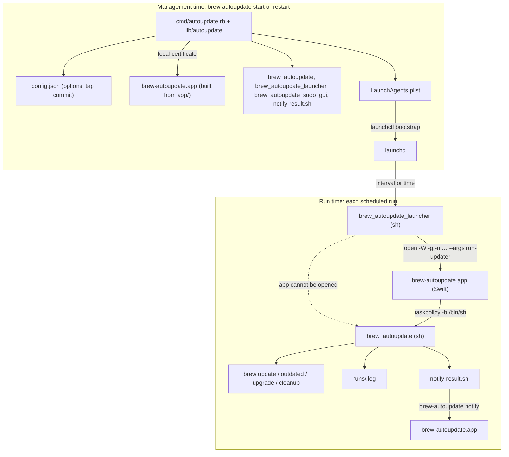

# Architecture

This document explains how `brew autoupdate` fits together, which design
decisions shape it, and the evidence behind each one. It is written for
maintainers and reviewers. Users want the [README](README.md); contributors
want [CONTRIBUTING](CONTRIBUTING.md).

Conventions used throughout:

- **Status** of a decision is one of:
  - **Current**: what the code does today, with no further decision made.
  - **Decided**: the maintainers' choice, which the code may not implement yet.
  - **Open**: still to be decided.
- ⚙ marks an option that can be automated (CI, a bot, or a check in code).
- **Verified** facts cite a source file and line, a URL, or a command that was
  run. **Experiment needed** marks a claim nobody has tested yet, together with
  the test that would settle it.
- Tests were run on an Intel Mac and an Apple silicon (M1) Mac, both on
  macOS 15.8.3 with Swift 6.1.2 (SDK 15.5) and Homebrew 5.1.x, unless stated
  otherwise.

## Contents

- [Goals](#goals)
- [Overview](#overview)
- [Components and boundaries](#components-and-boundaries)
- [Internal interfaces](#internal-interfaces)
- [Files on disk](#files-on-disk)
- [Lifecycles](#lifecycles)
- [Decisions](#decisions)
- [Known issues](#known-issues)
- [Appendix: experiments](#appendix-experiments)
- [Prior art](#prior-art)
- [This fork compared with upstream](#this-fork-compared-with-upstream)
- [Merging upstream or replacing it](#merging-upstream-or-replacing-it)
- [References](#references)

## Goals

- **G1. Subcommands register themselves.** Each subcommand is a
  `Homebrew::AbstractSubcommand` in its own file in `lib/autoupdate/`, so
  `cmd/autoupdate.rb` does not list subcommands, their options or their
  dispatch. See [D19](#d19-ruby-module-boundaries) and [D21](#d21-user-cli).
- **G2. The Ruby code is as clean and short as possible.** It is about 1,240
  lines, after adding local signing, building, restart reminders and per-run
  logs; the largest files are `lib/autoupdate/setup.rb` and
  `lib/autoupdate/script.rb`.
- **G3. No unnecessary duplication between Ruby, Swift and shell.** The
  support directory, the names `brew_autoupdate` and `brew_autoupdate.status`,
  and the bundle ID are still repeated across languages, checked by a test.
  See [D15](#d15-constants-shared-across-languages).
- **G4. Compatibility with DomT4's version is a non-goal.** The fork has its
  own label, bundle ID and paths, and has dropped legacy setups, the
  `notifier/notify.sh` forwarder and the hidden `--start`-style switches.
- **G5. Users can verify everything that runs without trusting the
  developers.** Every script a job runs is readable, and every executable can
  be rebuilt from source. See [D10](#d10-provenance-and-verification).
- **G6. Upgrading this tap does not affect running or registered jobs.** A
  `brew update` that pulls this tap must not change what an existing job
  executes, including partway through a run. See
  [D37](#d37-isolating-jobs-from-tap-upgrades).
- **G7 (relaxed for personal use). Users learn about an upgrade without
  running a subcommand.** A reminder that a restart is due is mandatory; the
  restart itself stays manual (`brew autoupdate restart`, see
  [D21](#d21-user-cli)). See [D38](#d38-applying-upgrades).
- **G8. A certificate generated on the user's machine,** with a clear warning
  (as [`mkcert`](https://github.com/FiloSottile/mkcert) does). Using no
  certificate (ad-hoc signing) was the first preference, but was dropped
  because every app change would cost the App Management grant. A
  developer's certificate would only be needed to distribute binaries, which
  G10 rules out. See [D39](#d39-signing-modes).
- **G9 (relaxed). Keep the app's identity stable.** The grant follows the
  local certificate, so it survives changes to the app, and the app no
  longer has to be a minimal launcher. Its main executable must still be
  compiled (see
  [the script app experiment](#a-shell-script-app)).
- **G10. No prebuilt binaries are distributed.** Every user builds the app
  from source on their own Mac. Anything that is ever distributed as a binary
  must be notarized; notarization is never bypassed, including by delivering
  an unnotarized binary through `git pull`, which escapes quarantine. This fork
  is not published for others to consume. See [D03](#d03-how-the-app-reaches-users)
  and [D07](#d07-notarization).

### Tensions between goals

- **G6 against G7:** jobs are isolated from upgrades, yet upgrades should
  reach them. The resolution is a manual restart between runs
  ([D38](#d38-applying-upgrades)).
- **G5 against developer-signed builds (resolved by G10):** users cannot
  check a developer's binary against their own rebuild unless both use the
  same toolchain, and the toolchain cannot be pinned (it comes from Homebrew's
  requirements). Building locally satisfies G5 fully, so no developer-signed
  build is offered.
- **G2 and G3 against G5:** moving logic into readable scripts helps auditing
  but can spread it across languages.

## Overview

`brew autoupdate start` builds and signs the app, writes everything a job
needs into the job's own folder and loads a launch agent. Each scheduled run
then goes through the app, so that macOS checks the app's permissions rather
than those of Homebrew's portable Ruby
([#163](https://github.com/DomT4/homebrew-autoupdate/issues/163)).

## Components and boundaries

The last column matters for G6: anything a job runs lives in the support
directory, written by `start` or `restart`, so a `brew update` that changes
the tap does not change a registered job.

| Component | Language | Runs when | Called by | Lives in |
| --- | --- | --- | --- | --- |
| `cmd/autoupdate.rb` | Ruby (`AbstractCommand`) | the user runs `brew autoupdate` | Homebrew | tap |
| `lib/autoupdate/{start,stop,restart,delete,status,logs,version}.rb` | Ruby (`AbstractSubcommand`) | management time | `cmd/autoupdate.rb` | tap |
| `lib/autoupdate/{setup,signing,launchd}.rb` | Ruby, needs Homebrew | management time | the subcommands | tap |
| `lib/autoupdate/{config,script,launch_agent,launcher,interval,notify,core}.rb` | Ruby, dependency-free | management time; loaded directly by tests | the modules above | tap |
| `app/build.sh` | shell | when `start` needs a new app, and in CI | `Autoupdate::Setup` | tap |
| `brew-autoupdate.app` | Swift (`app/BrewAutoupdate.swift`) | each run (`run-updater`) and for notifications (`notify`) | the launcher and `notify-result.sh` | support directory |
| `brew_autoupdate` (updater) | generated shell | each run | the app, or the launcher directly | support directory |
| `brew_autoupdate_launcher` | generated shell | each run | launchd | support directory |
| `brew_autoupdate_sudo_gui` | generated shell | when a cask upgrade needs `sudo` | `sudo -A` | support directory |
| `notify-result.sh` | static shell, copied from `app/` | end of each run | the updater | support directory |

## Internal interfaces

Every contract that crosses a language boundary, and where each side lives:

| Interface | Producer | Consumer | Contract |
| --- | --- | --- | --- |
| `run-updater` | the launcher | the app | `brew-autoupdate run-updater <log> <launcher-pid>`; the app runs the fixed script `~/Library/Application Support/com.github.hybras.homebrew-autoupdate/brew_autoupdate` with `BREW_AUTOUPDATE_RUN_BY_APP=1`, appends to `<log>`, and stops the update when `<launcher-pid>` exits. Both sides are built together by `start` |
| Exit status | the app | the launcher | written to `brew_autoupdate.status`, because `open -W` does not pass the app's exit status on |
| `notify` | `notify-result.sh` | the app | `brew-autoupdate notify <title> <subtitle> <message>` |
| Run result | the updater | `notify-result.sh` | `notify-result.sh <status> <run-log> <always\|error\|never> <app-path> <reminder>`; the outdated packages are in `<run-log>` with `.outdated.json` in place of `.log` |
| Saved options | `start` | `start` (resume), `restart`, `status` | `config.json`, `"version": 2`, including the tap's commit |
| App Management | the updater | `status` | `app_management` in the support directory: `granted`, `not granted` or `not checked: …`, with the time |
| Source hash | `app/build.sh` writes `BrewAutoupdateSourcesSHA256` | `Autoupdate::Setup.build_app` | `start` skips rebuilding when it matches `BrewAutoupdate.swift` + `build.sh` and the app is signed with the current certificate |
| Shared names | Ruby (`core.rb`), Swift, `build.sh` | all | support directory, script and status file names, bundle ID (duplicated and checked by `test/constants_test.rb`: G3, [D15](#d15-constants-shared-across-languages)) |

## Files on disk

`<label>` is `com.github.hybras.homebrew-autoupdate`.

| Path | Written by | Purpose |
| --- | --- | --- |
| `~/Library/LaunchAgents/<label>.plist` | `start` | schedule, logs, runs the launcher |
| `~/Library/Application Support/<label>/config.json` | `start` | saved options, captured environment and the tap's commit |
| `…/brew-autoupdate.app` | `start` (rebuilt when its source changes) | the app, signed with the local certificate |
| Login keychain: `brew-autoupdate local signing` | `start` (once) | the local signing certificate ([D40](#d40-local-signing-certificate)) |
| `…/brew_autoupdate`, `…/brew_autoupdate_launcher`, `…/brew_autoupdate_sudo_gui`, `…/notify-result.sh` | `start` (rewritten every time) | the job's scripts |
| `…/brew_autoupdate.status` | the app | exit status of the last run |
| `…/app_management` | the updater | whether the last run that upgraded casks had App Management |
| `~/Library/Logs/<label>/runs/<time>.log` and `<time>.outdated.json` | the updater | each run's output and the packages it upgraded; the newest 30 are kept ([D24](#d24-logging)) |
| `~/Library/Logs/<label>/<label>.out` | launchd and the app | one line per run, plus errors outside a run |
| The tap (`$(brew --repo hybras/autoupdate)`) | `brew update` | Ruby and `app/` sources; jobs only use them after a restart |
| TCC database (system-managed) | macOS | App Management and notification grants |

## Lifecycles

- **`start` (new):** validate options → create the signing certificate if
  needed → save `config.json` with the tap's commit → build and sign the app
  unless it is current → write the scripts → write the plist →
  `launchctl bootstrap gui/<uid>`.
- **`start` (resume after `stop`, no options):** reuse `config.json`, then
  do the same.
- **`restart`:** `bootout` if loaded, then the same with the saved options.
- **`stop`:** `launchctl bootout`; files kept. The app notices that the
  launcher has exited and stops the running update.
- **`delete`:** `bootout`, delete the signing certificate and its key from
  the login keychain, then remove the plist, the support directory and the
  logs.
- **`status`:** loaded state (exact `launchctl print`), options from
  `config.json`, run log folder, who signed the app, the last App Management
  result, and the restart reminder when the tap's commit has changed.
- **A scheduled run:** launchd → launcher → `open` → app →
  `taskpolicy -b /bin/sh brew_autoupdate` → App Management check →
  `brew update && brew outdated && brew upgrade … && brew cleanup` → restart
  check → `notify-result.sh` → app `notify` → old run logs pruned.
- **A tap upgrade during a run:** the run's `brew update` may change the tap,
  but the job only runs files in its support directory, so the run is
  unaffected; it reminds the user to restart.
- **Failure paths:** the command chain stops at the first failure; the status
  is reported in the run's log and a notification; if the app cannot be
  opened, the launcher runs the updater directly.

## Decisions

Each entry follows the same format: status, the question, options with
trade-offs, research and the goals it touches.

### A. Packaging and scheduling

#### D01. Scheduler

- **Status:** Decided: keep our own launch agent. `brew services` would fix
  options in a formula.
- **Options:**
  - our own launch agent in the user's GUI domain (current)
  - `brew services` through a formula with a `service do` block: Homebrew
    supports `run_type :interval` and `:cron`, `process_type` and
    `run_at_load`, with the label `homebrew.mxcl.<formula>`
    (`Library/Homebrew/service.rb`). Options are fixed in the formula, so
    per-user options would come from a config file.
  - Homebrew's built-in `HOMEBREW_AUTO_UPDATE_SECS`, which only runs when the
    user invokes `brew`
  - cron
- **Goals:** G2, G6.

#### D02. How the command is delivered

- **Status:** Decided: keep the Ruby `AbstractCommand` in `cmd/autoupdate.rb`;
  it is needed for self-registering subcommands (G1).
- **Options** ([External Commands](https://docs.brew.sh/External-Commands)):
  - `cmd/autoupdate.rb` (current)
  - an executable `brew-autoupdate` (any language; receives `HOMEBREW_*`
    variables; no access to Homebrew internals)
  - a legacy `brew-autoupdate.rb`
  - a formula-installed command
  - moving the feature into Homebrew itself
- **Research:**
  - Ruby commands use Homebrew internals "without compatibility guarantees",
    so public APIs are preferred.
  - Command resolution takes the first tap that provides a command
    (`Library/Homebrew/commands.rb`), so this tap and DomT4's cannot both be
    installed.
- **Goals:** G1, G2.

#### D03. How the app reaches users

- **Status:** Decided: `start` builds the app from source on the user's Mac
  and signs it there ([D39](#d39-signing-modes)). The repository holds only
  source; the previously committed binary is gone.
- **Options:**
  - a binary committed in git (previous; rejected by G10: an unnotarized
    binary delivered through git escapes quarantine rather than passing
    notarization)
  - built on the user's machine from source by `start` (decided)
  - a cask installing a notarized GitHub release ⚙ (rejected by G10: nothing
    is distributed; it would need notarization, since downloads are
    quarantined and `cask/audit.rb` fails artifacts that do not pass
    Gatekeeper)
  - `start` downloads a release with `curl` (rejected by G10: it escapes
    quarantine the same way git does)
  - a cask or formula that builds the app from source (rejected, see
    [D03b](#d03b-a-cask-that-builds-or-assembles-the-app))
- **Rejected or constrained by experiment:**
  - A shell-script main executable: macOS holds `/bin/sh` responsible, and
    interpreted Swift cannot post notifications
    ([details](#a-shell-script-app)).
  - Detached signatures applied to local builds (the Bitcoin Core model):
    works only if users can reproduce the exact binary, which needs a pinned
    toolchain, and the toolchain cannot be pinned
    ([details](#detached-signatures)).
  - A wrapper app around a symlink (the pattern of the `dissent-app` cask in
    `hybras/homebrew-tap`): macOS resolves the symlink and judges the target
    binary, so grants are lost whenever the target changes
    ([details](#wrapper-app-around-a-symlink)).
- **Goals:** G5, G6, G8, G9.

#### D03b. A cask that builds or assembles the app

- **Status:** Decided: rejected. `start` builds and signs instead.
- **Research (verified in Homebrew's source):**
  - Quarantine is applied when a download is extracted
    (`cask/download.rb:128`), before `preflight_steps` run, so files a
    preflight step creates are not quarantined. A locally built app would
    need no notarization.
  - Preflight steps run in Homebrew's cask sandbox
    (`cask/artifact/install_steps.rb`, `cask/artifact/abstract_artifact.rb:216`):
    writes are limited, the network is off unless a step asks for it, and
    `HOME` is set to a temporary directory
    (`cask/artifact/abstract_artifact.rb:239-258`). Reading the real
    `~/Library/Keychains` is denied as well (`sandbox.rb:527`). `codesign`
    therefore cannot reach a signing identity in the login keychain, whether
    self-signed or a free Apple Development certificate. The cask could only
    sign ad-hoc.
  - On Apple silicon, keg relocation re-signs ad-hoc only the binaries it
    patches (`extend/os/mac/keg.rb`, `keg_relocate.rb`).
- **Why rejected:**
  - Signing with the local certificate would still have to happen in `start`,
    outside the sandbox, so a cask would only duplicate the build step.
  - `brew upgrade` would replace the app on its own schedule, possibly during
    a run, which breaks G6.
- **Experiment not run:** a test cask that calls `codesign` with a keychain
  identity in a preflight step (expected to fail, from the code above).
- **Goals:** G5, G6, G8, G10.

#### D04. Dependency between the command and the app

- **Status:** Decided by [D37](#d37-isolating-jobs-from-tap-upgrades): `start`
  builds the app from the same tap commit as the scripts it writes, so they
  cannot drift apart.
- **Options:** same commit (previous) / `start` installs or checks a cask /
  version negotiation through capabilities.

#### D05. Fixing it in Homebrew instead

- **Status:** Decided: not pursued; out of scope for a personal fork.
- **Research:** portable Ruby is "not signed at all" on Intel
  (`codesign -d`), and Homebrew re-signs binaries ad-hoc on Apple silicon. If
  Homebrew signed portable Ruby with a Developer ID, the Ruby's own grant
  would survive upgrades for every brew user. Homebrew already signs its
  `.pkg` installer in CI (`.github/workflows/release.yml` in Homebrew/brew).

### B. CI/CD and trust

#### D06. Who builds and signs

- **Status:** Decided by [D39](#d39-signing-modes) and G10: users build and
  sign on their own Mac. CI builds with an ad-hoc signature only to test, and
  publishes nothing for users to run.
- **Research:** should a signed CI build ever be needed, GitHub's documented
  recipe imports a base64 `.p12` into a temporary keychain
  (`security create-keychain`, `import`, `set-key-partition-list`); hosted
  runners are destroyed after the job.

#### D07. Notarization

- **Status:** Decided: notarization is never bypassed (G10). Nothing is
  distributed as a binary, so nothing needs notarizing; any future
  distributed binary must be notarized. Apps built and signed on the user's
  Mac are not distributed and are never quarantined.
- **Research:**
  - Apple: "Beginning in macOS 10.15, all software built after June 1, 2019,
    and distributed with Developer ID must be notarized"
    ([Apple](https://developer.apple.com/documentation/security/notarizing-macos-software-before-distribution)).
  - Verified with `spctl -a -vv -t exec` on both test Macs: upstream's app is
    "rejected, source=Unnotarized Developer ID". It still runs because it is
    not quarantined, and Gatekeeper only enforces its verdict when launching
    quarantined files.
  - Notarization requires a Developer ID, the Hardened Runtime and a secure
    timestamp; it is done with `notarytool`, and stapling is recommended.
- **Consequences recorded with the decision:**
  - Upstream's approach, a Developer ID app without notarization delivered
    through git, is not acceptable: it relies on git not quarantining files.
  - An earlier decision here ("sign only, no notarization", with a CI-signed
    binary in git) was reversed for that reason.
  - [#255](https://github.com/DomT4/homebrew-autoupdate/issues/255) reports
    that macOS 27 refuses notification permission to unnotarized apps,
    including ad-hoc and self-signed ones (unverified here). If that holds,
    local builds on macOS 27 cannot post notifications; scheduled updates
    still run, and results stay visible in `status` and the log
    ([D29](#d29-notifications)).

#### D08. Release trigger and changelog

- **Status:** Decided: keep `version: bump` commits, with no release
  automation. The restart reminder uses the tap's commit
  ([D38](#d38-applying-upgrades)), so nothing depends on releases.
- **Options:** current / a tag-driven release workflow ⚙ / a release bot ⚙ /
  GitHub release notes ⚙.

#### D09. Versioning

- **Status:** Decided: keep one `VERSION` file.
- **Options:** shared version (current) / a separate app version /
  capability-only compatibility.

#### D10. Provenance and verification

- **Status:** Decided: users build from source, so there is no binary to
  verify (G5, G10).
- **Options:**
  - the source-hash guard (previous, ⚙): CI checked that the committed app was
    built from the current sources. Removed with that app; `start` now uses
    the same hash to skip needless rebuilds
  - build attestation in CI (`actions/attest-build-provenance`, checked with
    `gh attestation verify`) ⚙; not needed while nothing is distributed
  - reproducible builds plus a `brew autoupdate verify` command ⚙
- **Research (verified):**
  - Builds are bit-for-bit reproducible with the same Swift and SDK, across
    paths and across Intel and Apple silicon hosts.
  - They are not reproducible across SDK versions (SDK 15.5 against CI's
    26.5). See [the reproducibility experiment](#reproducible-builds).
  - Homebrew's own guidance: [Reproducible Builds](https://docs.brew.sh/Reproducible-Builds)
    (`SOURCE_DATE_EPOCH`, path placeholders, deterministic gzip).

#### D11. Whose certificate

- **Status:** Decided by [D39](#d39-signing-modes) and G10: no developer
  certificate. The only certificate is one the user's own Mac generates
  ([D39](#d39-signing-modes)).
- **Research:**
  - Upstream signs with "Developer ID Application: Dominyk Tiller
    (S8FDSZ4D97)", an individual Apple Developer Program membership, not
    Homebrew's team.
  - DomT4 described the app as "code-signed for reassurance"
    ([#91](https://github.com/DomT4/homebrew-autoupdate/issues/91)); it was
    never notarized.

#### D12. Automated updates

- **Status:** Decided: keep Dependabot and the README help regeneration ⚙.
- **Options:** if a cask is added, `livecheck` plus the autobump workflow that
  `brew tap-new` generates (`brew bump --no-fork --open-pr --bump-synced`) ⚙.

### C. Boundaries

#### D13. Where scheduled-run logic lives

- **Status:** Decided: keep the generated updater script, written into the
  job's snapshot by `start`. A hidden `brew autoupdate run` would run whatever
  the tap holds at the time, which breaks the snapshot
  ([D37](#d37-isolating-jobs-from-tap-upgrades)), and would make every run
  depend on the command being trusted.
- **Options:**
  - a generated script (current)
  - a hidden `brew autoupdate run` that reads `config.json`, so every run uses
    the latest code. Homebrew itself re-executes after updating
    (`utils/auto-update.sh:127-128`; `cmd/update.sh:1149` hands off to
    `brew update-report`). Costs about a second of startup and requires the
    command to be trusted; today scheduled runs work even when it is not.
  - logic in the Swift app
- **Goals:** G2, G3, G5, G6.

#### D14. Script or config as the interface

- **Status:** Decided: the app runs the generated script
  ([D13](#d13-where-scheduled-run-logic-lives)).
- **Options:** the app runs a generated script (current) / the app or Ruby
  reads `config.json` directly.

#### D15. Constants shared across languages

- **Status:** Decided: keep the duplicates and add a test ⚙ that reads the
  Swift source and `app/build.sh` and checks they match Ruby's constants. It
  catches a missed rename ([D32](#d32-label-bundle-id-and-paths)) for little
  code.
- **Options:** keep duplicates / pass every path as an argument and validate
  it / generate one side from the other ⚙ / a test that asserts they match ⚙.

#### D16. Launcher

- **Status:** Decided: keep the shell launcher using `open -W`. `SMAppService`
  is untested and would restructure the app.
- **Options:**
  - a shell launcher (current)
  - the plist runs `open` directly
  - the app registers its own agent with `SMAppService` (macOS 13+; the
    agent's plist lives in the app's `Contents/Library/LaunchAgents`;
    registration needs the user's approval)
  - no launcher, which gives up App Management attribution
- **Experiment needed:** whether macOS attributes an `SMAppService` agent's
  child processes to the app.

#### D17. Contract between the app and the launcher

- **Status:** Decided: drop the `run-updater-1` capability marker and its
  checks in Ruby and the launcher. It existed because the tap's app could be
  older than the launcher; now `start` builds both together (G2, G3). Keep the
  status file and the launcher PID.
- **Options:** the current contract / a `capabilities` subcommand / versioned
  subcommand names.
- **Experiment needed:** whether `open -W` can report the app's exit status.

#### D18. Summarizing results

- **Status:** Decided: summarize from structured data. After `brew update`,
  the updater runs `brew outdated --json=v2` with the same scope as its
  upgrade (`--greedy`, `--formula` or `--cask`, the `--only` names or the
  leaves) and saves the result with the run's log. On success,
  `notify-result.sh` lists each package with its old and new version using
  `/usr/bin/jq` (shipped with macOS 15, see
  [D33](#d33-minimum-macos-version)), skipping pinned formulae; an empty list
  means nothing needed upgrading. Failures still show the end of the log.
  Caveat: the list is what was outdated before the upgrade; it equals what was
  upgraded only because the run stops at the first failure
  ([D26](#d26-failure-semantics)).
- **Options:** text parsing (previous) / structured data from
  `brew outdated --json=v2` (`name`, `installed_versions`, `current_version`,
  `pinned`) / summarizing in Swift.

#### D19. Ruby module boundaries

- **Status:** Decided: adopt `Homebrew::AbstractSubcommand` (G1), with
  subcommand classes nested under `Homebrew::Cmd::Autoupdate`. `lib/` is then
  loaded before `cmd_args`, which makes `--help` slightly slower; accepted.
- **Research (verified in Homebrew's source):**
  - `Homebrew::AbstractSubcommand` (`abstract_subcommand.rb`, `@api public`)
    lets each subcommand declare its own `subcommand_args` and `run`. The
    parent calls `AbstractSubcommand.define_all(self, command:)`. `brew
    bundle` is the reference (`cmd/bundle.rb`, `bundle/subcommand/*.rb`).
  - Subcommand classes must be nested under `Homebrew::Cmd::Autoupdate`,
    because `subcommands_for` matches by namespace, and they must be loaded
    before `cmd_args` runs. Today the command delays loading `lib/` to keep
    `--help` fast.
  - `alias_options` maps a word to a switch (`bundle upgrade` →
    `install --upgrade`); it cannot replace switch-style legacy subcommands.
  - It first shipped in Homebrew 5.1.12 (see [D36](#d36-minimum-homebrew-version)).
- **Current convention:** dependency-free modules can be tested with plain
  `ruby`; Homebrew-dependent modules prefer Homebrew helpers
  (`SystemCommand`, `odie`).

#### D20. Swift structure

- **Status:** Decided: one file, moved to the Swift 6 language mode.
- **Options:** a single file (current) / several files with `swift test` ⚙ /
  Swift 6 language mode.

#### D37. Isolating jobs from tap upgrades

- **Status:** Decided: one snapshot in the support directory. `start` writes
  the scripts, `notify-result.sh` and `brew-autoupdate.app` there, so nothing
  a job runs comes from the tap. The app is built in a temporary directory
  and renamed into place only after signing and verification succeed, as
  `app/build.sh` already does.
- **Options:**
  - jobs use files in the tap (previous; violates G6)
  - one snapshot in the support directory (decided)
  - versioned snapshot directories with an atomic `current` symlink and the
    previous one kept for rollback (the Nix pattern) ⚙; not needed (YAGNI)
- **Research:**
  - A moved app keeps its grants when its identity is stable
    ([D39](#d39-signing-modes), [details](#app-management-grants)).
  - Notifications require the app to live under the home folder, not `/tmp`
    ([details](#notifications)).
  - Renaming a new app over the old one is safe during a run: the running
    process keeps the old file open.

#### D38. Applying upgrades

- **Status:** Decided: a manual restart, with a mandatory reminder. Source
  code changes in the tap (a `brew update` that pulls this fork, or local
  edits) must be followed by a job restart: `brew autoupdate restart`
  ([D21](#d21-user-cli); until it exists, `stop` then `start`), which rebuilds
  the snapshot ([D37](#d37-isolating-jobs-from-tap-upgrades)) from the saved
  options and keeps App Management, because the certificate is unchanged
  ([D40](#d40-local-signing-certificate)). Until then the job keeps running
  its old snapshot.
- **Reminders: mandatory.** The restart stays manual, but the user must be
  reminded that one is due:
  - **Source of truth:** `start` records the tap's git commit in
    `config.json`. A restart is due when the tap's `HEAD` differs. A commit
    is used rather than `VERSION`, because most changes land without a
    version bump.
  - **The job:** after its `brew update` step, the updater compares the
    two in shell (no Ruby, so no trust needed), writes the reminder to the
    log, and adds it to the run's notification.
  - **`status`:** shows the same reminder, so it is still seen when
    notifications are refused
    ([macOS 27](#macos-27-may-refuse-notifications)).
  - This replaces the 90-day warning.
  - Not covered: uncommitted local edits, which leave `HEAD` unchanged. Whoever
    makes them knows to restart.
- **Rejected: self-refresh** (the updater ending with
  `exec brew autoupdate refresh`). Since the app is built on the user's Mac,
  an automatic refresh means unattended builds and signing from the job:
  failures with no one watching, the keychain unlocked from launchd, and
  scheduled runs depending on `brew autoupdate` being trusted. Too much work
  for one user. (Had it been chosen, `exec` would have been needed: `bash`
  reads a script while running it, so rewriting the updater mid-run could
  corrupt that run.)
- **Reminder channels considered (combinable):**
  - the job checks after its `brew update` step and records that an upgrade is
    available
  - a notification
  - the job regenerates its own snapshot at the end of a run and uses it next
    time ⚙ (rustup's self-update, with a `check-only`-style opt-out)
  - `status` and every `brew autoupdate` command report it
  - the 90-day warning becomes this version check
- **Research:**
  - Homebrew has no tap post-update hook, and `brew update` disables git hooks
    (`git -c core.hooksPath=/dev/null`, `cmd/update.sh:82-85`).
  - The command's Ruby only loads when `brew autoupdate` runs (`brew.rb:101`)
    or when its parser is read for help, completion or man pages
    (`commands.rb:259-353`, `help.rb:103`, `completions.rb:153`,
    `manpages.rb:82`). A check therefore belongs in `run`, not at load time.
  - Regenerating from the job needs either Ruby (and so trust, see
    [D13](#d13-where-scheduled-run-logic-lives)) or a generator inside the
    snapshot.

#### D39. Signing modes

- **Status:** Decided: one mode, so there is no `--signing` option. `start`
  builds the app from source with the user's toolchain and signs it with a
  self-signed certificate created on the user's Mac, with an `mkcert`-style
  warning. When the app changes, it is rebuilt and re-signed with the same
  certificate and grants are kept. The app's main executable is compiled, the
  job's snapshot lives under `~/Library/Application Support`, and the bundle
  ID never changes after the rename in [D32](#d32-label-bundle-id-and-paths).
  How the certificate is managed is [D40](#d40-local-signing-certificate).
- **Dropped modes:**
  - `developer` (a CI-signed binary committed to git), by G10.
  - `adhoc`: its identity is the code hash, so every change to the app's
    source or the user's toolchain would lose the App Management grant and
    need it granted again by hand. Ad-hoc signing remains only for test
    builds in CI and development, which never run real jobs.

- **Research (verified):**
  - Notification permission belongs to the bundle ID and is never requested
    again when the signature changes ([details](#notifications)).
  - Grants survive a certificate's expiry; an expired certificate only stops
    new builds from being signed ([details](#certificate-expiry)).
- **Requirements:**
  - `status` shows who signed the app, and whether App Management was
    granted at the last run that upgraded casks. The System Settings list
    proved unreliable ([details](#system-settings-is-not-reliable)), so each
    such run does what Homebrew's
    `Cask::Quarantine.app_management_permissions_granted?` does: it writes a
    file into an app bundle it owns, in `~/Applications` or `/Applications`,
    and removes it. Only a run started by the app records a result, since
    macOS judges the process responsible for the write: the same check from
    `status` would test the terminal's permission instead, and prompt to
    grant App Management to the terminal.
  - Signing happens in `start`, outside Homebrew's sandbox; a cask cannot
    reach the keychain ([D03b](#d03b-a-cask-that-builds-or-assembles-the-app)).
  - The local certificate's risk (any process running as the user can sign
    with the key) is accepted, because only the maintainer uses this fork
    (G10). It would need revisiting before anyone else does.

#### D40. Local signing certificate

- **Status:** Decided.
  - **Keychain:** the user's login keychain, so no password is stored
    anywhere. The certificate is imported with `-T /usr/bin/codesign` but no
    `set-key-partition-list`, so the first `codesign` use asks for the login
    password in a macOS dialog; "Always Allow" lets later builds sign without
    asking. Signing only happens in an interactive `start` or `restart`
    ([D38](#d38-applying-upgrades)), where the user can answer. Only the
    login keychain is searched for the identity.
  - **Creation:** `/usr/bin/openssl` (LibreSSL), with an `extendedKeyUsage`
    of `codeSigning`, exported as a `.p12` with legacy algorithms
    (`-macalg sha1 -keypbe PBE-SHA1-3DES -certpbe PBE-SHA1-3DES`); OpenSSL 3's
    default `.p12` fails to import. The `.p12`'s random password exists only
    while `start` runs.
  - **Name and validity:** `brew-autoupdate local signing`, valid for 10
    years. `codesign` refuses an expired identity, and a new certificate means
    granting App Management again; validity is never checked after signing.
  - **No trust setting:** grants followed the certificate without one, and
    adding one would need an administrator prompt.
  - **Warning:** the first `start` says, `mkcert`-style, what it created, the
    risk, and how to remove it.
  - **Missing certificate:** `start` creates a new one and says App
    Management must be granted again.
  - **`delete`:** removes the certificate and its key from the login
    keychain (`security delete-identity`); a later `start` creates a new one.
- **Rejected:** a dedicated keychain whose random password was stored in the
  support directory, so `codesign` could use it unattended. It was the first
  implementation; the user preferred typing their login password over a
  password on disk.
- **Research (verified):** the throwaway keychain in the
  [App Management experiments](#app-management-grants) signed with no prompt.
  The login-keychain prompt is not yet verified.

### D. Command-line interfaces

#### D21. User CLI

- **Status:** Decided: subcommands register themselves
  ([D19](#d19-ruby-module-boundaries)); add `restart` (`stop`, then `start`
  with the saved options), which the restart reminder names
  ([D38](#d38-applying-upgrades)); `start` keeps resuming saved options; drop
  the hidden legacy switches (G4); `delete` keeps removing logs. No other new
  commands; `status` reports whether App Management is granted
  ([D39](#d39-signing-modes)).
- **Topics:**
  - registration through `AbstractSubcommand` (G1)
  - implicit resume in `start` against an explicit `restart`
  - candidate commands: `run-now`, `permissions` or `doctor` (a real
    App Management check), `verify` (G5), `config`,
    `status --json`
  - whether `delete` removes logs
  - consistent flag names (`--immediate`, the three notification flags,
    `--only`)
  - dropping the hidden legacy switches (G4)

#### D22. Helper app CLI

- **Status:** Decided: keep `notify` and `run-updater`.
- **Open:** which commands exist, who may call them, input validation, a
  permission self-check, `--version`.

#### D23. Arguments of the notify script

- **Status:** Decided: keep positional arguments.
- **Options:** positional (current) / named options / folded into the app.

### E. Behaviour and operations

#### D24. Logging

- **Status:** Decided: one log file per run. Each run writes
  `~/Library/Logs/<label>/runs/<timestamp>.log`, and the updater deletes all
  but the newest 30 ⚙. launchd keeps its `StandardOutPath` for errors outside
  a run. `brew autoupdate logs` shows the newest run's log. A notification
  that opens its run's log needs an app change and is not planned.
- **Options:**
  - keep the shared file and prune it on each run ⚙ (a user-level `newsyslog`
    configuration is not available)
  - **one file per run**, keeping the temporary log under a timestamped name
    with a retention policy ⚙. The notification can then open that run's log,
    `status` can show the last result, and `logs` can list runs. launchd
    still needs a `StandardOutPath` for errors outside a run.
  - unified logging (`os_log`): nothing to manage, but harder for users to
    find and share

#### D25. Resource policy

- **Status:** Decided: keep the current policy: background process type,
  `taskpolicy -b`, no builds from source
  (`HOMEBREW_NO_BOTTLE_SOURCE_FALLBACK=1`), optional `--ac-only`.
- **Open:** network and Low Power Mode checks.

#### D26. Failure semantics

- **Status:** Decided: keep the `&&` chain, which stops at the first failure.
- **Open:** whether casks should still upgrade after a formula failure;
  retries.

#### D27. `sudo`

- **Status:** Decided: keep the pinentry-mac `SUDO_ASKPASS` helper, or the
  user's own `SUDO_ASKPASS`. Homebrew passes `-A` to `sudo` whenever
  `SUDO_ASKPASS` is set (`system_command.rb:359`).

#### D28. Security model

- **Status:** Decided: document the accepted risks; nothing to build.
- **Current safeguards:** the app runs only a fixed script path and refuses
  files that other users could have replaced; `--only` package names are
  validated before they are written into a script.
- **Accepted risks:**
  - Code the user can write (the job's scripts, Homebrew, taps) runs with
    the app's App Management permission. Granting Ruby or a terminal has the
    same exposure.
  - Any process running as the user can sign code with the local
    certificate ([D40](#d40-local-signing-certificate)).
  - Each run that upgrades casks briefly writes a file into an app the user
    owns, to record App Management ([D39](#d39-signing-modes)), as Homebrew
    does before each cask upgrade.
  - All are accepted because only the maintainer uses this fork (G10).

#### D29. Notifications

- **Status:** Decided: notifications stay as they are, and the possible
  macOS 27 refusal is not handled for now
  ([known issue](#macos-27-may-refuse-notifications)).
- **Research:** no certificate is needed on macOS 15 when the app lives under
  the home folder ([details](#notifications)).
- **Options for later:** make notifications optional and report failures in
  `status` and the log. Notarizing is not available, because nothing is
  distributed (G10, [D07](#d07-notarization)).

### F. Identity and compatibility

#### D30. Setups created by older versions

- **Status:** Decided: drop support (G4). The rename in
  [D32](#d32-label-bundle-id-and-paths) needs a fresh `start` anyway.

#### D31. Shims

- **Status:** Decided: remove `notifier/notify.sh` (G4).

#### D32. Label, bundle ID and paths

- **Status:** Decided: rename `com.github.domt4.homebrew-autoupdate` to
  `com.github.hybras.homebrew-autoupdate` in the launchd label, support and
  log directories, and the bundle ID (`….autoupdater`).
- **Why now:** App Management has to be granted again anyway for the new
  certificate ([D40](#d40-local-signing-certificate)). The rename resets
  notification permission once.
- **No migration (G4):** remove the old setup with `brew autoupdate delete`
  before switching; the fork no longer manages upstream's launch agent.

#### D33. Minimum macOS version

- **Status:** Decided: macOS 15, matching Homebrew's oldest supported version
  (`HOMEBREW_MACOS_OLDEST_SUPPORTED`, `brew.sh:362`). The app declares it
  and is built for it.

#### D36. Minimum Homebrew version

- **Status:** Decided: require Homebrew 5.1.12 or later, with no fallback; the
  maintainer runs current Homebrew.
- **Options:** require it / check the version and fail clearly / detect the
  feature and fall back. Running CI against the oldest supported version ⚙.

### G. Style and conventions

#### D34. Style per language

- **Status:** Decided, per language below.
- **Ruby:** `brew style` (current ⚙; taps use `tap_rubocop_style.yml`). No
  Sorbet signatures in `lib/`: its dependency-free modules are tested with
  plain `ruby`, which cannot load `sig`. `cmd/` keeps `typed: strict`.
- **Swift:** `swift format`, which ships with the toolchain ⚙.
- **Shell:** ShellCheck with every check enabled, plus shfmt, through
  `brew style` (current ⚙). A tap inside the Homebrew checkout inherits
  Homebrew's `.shellcheckrc`, which disables SC2310–SC2312; CI does not, so
  local and CI results can differ. CONTRIBUTING gives the command that
  matches CI.
- **Markdown:** markdownlint in the editor only, not in CI.
- **Tests:** keep plain-Ruby minitest. `AbstractSubcommand` classes need
  Homebrew loaded, so they are tested through `brew` (`test/command_test.rb`).
- **Commits and spelling:** upstream uses `area: summary` subjects.

### H. Relationship to upstream

#### D35. Merge or replace

- **Status:** Decided for now: neither. This fork is not published for others
  to consume (G10). See [Merging upstream or replacing it](#merging-upstream-or-replacing-it)
  for what either would involve.

## Known issues

### macOS 27 may refuse notifications

- **Status:** not handled for now ([D29](#d29-notifications)). Unverified:
  no macOS 27 machine has been tested.
- **Report:** [#255](https://github.com/DomT4/homebrew-autoupdate/issues/255)
  (macOS 27.2, Apple silicon) says macOS refuses notification permission,
  with no prompt, to apps that are not notarized: upstream's Developer ID
  app, and ad-hoc and self-signed apps too. Notarized apps work. The app
  built by `start` is self-signed and cannot be notarized (G10,
  [D07](#d07-notarization)), so it would be affected.
- **What would stop working:**
  - the notification after each run, including failures and the reminder
    that a restart is due ([D38](#d38-applying-upgrades)); `status` still
    shows the reminder
- **What would keep working:**
  - scheduled updates, which do not depend on notifications
  - each run's output in `brew autoupdate logs`, which records "could not
    display the update result" (`app/notify-result.sh`). `status` does not
    show run results today.
- **Untested on macOS 27:** App Management through the self-signed app,
  which is a separate permission and is not covered by the report.
- **If it is confirmed:** take up the options in [D29](#d29-notifications),
  starting with making `status` show the last run's result.

## Appendix: experiments

All experiments ran with a probe that calls Homebrew's own check,
`Cask::Quarantine.app_management_permissions_granted?`, against an installed
cask app (Bartender 5). It was launched as macOS would launch a job:
`open -W -g -n <app> --args run-updater`. The TCC log
(`log show --predicate 'process == "tccd"'`) confirmed which identity macOS
held responsible each time. A never-granted control app was always denied,
which shows the probe distinguishes real grants.

### Reproducible builds

Builds of the same commit with `CODESIGN_IDENTITY=- app/build.sh <out>`:

| Build | Code hash | Executable SHA-256 | Mach-O UUIDs |
| --- | --- | --- | --- |
| Intel, twice from the repo | `defe64ac…` | `56553707619f…` | `C33E0F3E…`, `16BEFE79…` |
| Intel, source at another path | same | same | same |
| M1, same Swift 6.1.2 and SDK 15.5 | same | same | same |
| CI, `macos-26-arm64`, SDK 26.5 | different | `dd54341d2b28…` (about 65% of bytes differ) | different |

- The builds embed no paths.
- Reproducibility depends on the toolchain, not on the machine or the CPU.

### App Management grants

| App | Signature | Before a grant | After granting the first build |
| --- | --- | --- | --- |
| A | ad-hoc | denied | allowed |
| B: identical rebuild in another folder | ad-hoc, same code hash | n/a | allowed |
| C1 | self-signed certificate | denied | allowed |
| C2: a different binary with the same certificate | self-signed | n/a | allowed |
| D: control, never granted | ad-hoc | n/a | denied |

- The results were the same on Intel and on Apple silicon.
- Ad-hoc grants follow the code hash; self-signed grants follow the
  certificate, with no trust setting needed.
- A grant was kept when portable Ruby switched from 4.0.10 to 4.0.9_1,
  because macOS checked the app, not Ruby.
- To be signed unattended, the self-signed identity had to be in a keychain on
  the user's search list, and the `.p12` had to be created with LibreSSL's
  legacy algorithms.

| How the app changed | Ad-hoc | Self-signed | Developer ID |
| --- | --- | --- | --- |
| Identical bytes | kept | kept | kept |
| Changed source or a different toolchain | lost | kept with the same certificate | kept with the same team and bundle ID (requirement verified; an actual rebuild not tested) |
| Moved to another folder | kept | kept | kept |
| Bundle ID changed | lost | lost | lost |

### Certificate expiry

- `codesign` refuses to sign with an expired identity
  (`CSSMERR_TP_CERT_EXPIRED`).
- A grant for apps signed before the expiry was still honoured after it, even
  with the certificate deleted from the keychain.

### Notifications

Every variant used a fresh bundle ID and an ad-hoc signature:

| Location | Result |
| --- | --- |
| `/tmp` (Intel and M1, with or without `lsregister`) | refused with no prompt ("Notifications are not allowed for this application") |
| `~/Applications` (M1) | prompt shown; allowed |
| `~/Library/Application Support` (Intel and M1) | prompt shown; allowed |

- Permission belongs to the bundle ID: `~/Library/Preferences/com.apple.ncprefs.plist`
  lists one entry per bundle ID, with each signature seen added as another
  source.
- A rebuilt or moved app keeps the permission once LaunchServices has
  registered it.

### System Settings is not reliable

- A blocked attempt showed the "prevented from modifying apps" notification,
  but the app did not appear in the App Management list.
- Adding apps with "+" did not make them appear either, yet macOS then allowed
  them.
- Onboarding and `status` should therefore check access for real rather than
  point users at the list.

### A shell-script app

An app whose main executable is a constant shell script that runs Swift
scripts with `/usr/bin/swift`:

| Question | Result |
| --- | --- |
| Is the ad-hoc signature identical every time? | yes; it is stored in `Contents/_CodeSignature/` |
| Is the app the responsible process? | no: the TCC log shows `responsible=com.apple.sh` (`/bin/bash`) |
| Does the Swift script inherit the app's permission? | no: denied (`Operation not permitted`) |
| Can the Swift script post notifications? | no: `UNUserNotificationCenter` throws; interpreted Swift runs inside `swift-frontend`, which has no app bundle |

### Wrapper app around a symlink

`~/Applications/Dissent.app` (installed by the `dissent-app` cask) has a
symlink as its main executable, pointing at
`/usr/local/opt/dissent/bin/dissent`, which resolves to the versioned
`/usr/local/Cellar/dissent/0.0.41/bin/dissent`. Neither the bundle nor the
binary is signed. macOS follows the symlink, so the identity is the target's
code hash, or its versioned path when it is unsigned, and both change with
every upgrade. #163 is the same mechanism (`portable-ruby/current` →
`4.0.10`).

### Detached signatures

- Bitcoin Core keeps macOS release signatures in a separate repository
  (`bitcoin-core/bitcoin-detached-sigs`). Builders reproduce the unsigned app
  deterministically and attach the signatures (`contrib/macdeploy/README.md`,
  `contrib/guix/guix-codesign`, with `achow101/signapple` providing `apply`).
- This requires a byte-identical build, which in turn requires a pinned
  toolchain. Homebrew users' toolchains cannot be pinned, so the approach does
  not work here.
- Apple's own `codesign --detached` is only honoured system-wide through a
  root-only database, so it cannot help either.

## Prior art

How other updaters stay consistent while updating themselves:

| Updater | Approach |
| --- | --- |
| Homebrew | updates, then re-executes itself before doing anything else |
| Nix | immutable store paths and an atomic symlink switch, with generations for rollback |
| Sparkle | a separate installer component and signature checks before installing |
| rustup | self-update is a separate step that can be enabled, disabled or set to check only |
| MacPorts | `selfupdate` updates its base before the ports tree, and keeps old versions |

The patterns that apply here: update the updater first and re-execute; stage
then switch atomically; keep the updater separate from what it updates; verify
before switching; keep a rollback target; version the contract between
components.

## This fork compared with upstream

This fork is about 40 commits ahead of `DomT4/homebrew-autoupdate`.

**Better:**

- Scheduled runs go through the app, so App Management survives portable Ruby
  upgrades (#163, #253), and `status` shows whether the last run had it.
- The app is built from source and signed on the user's Mac with a local
  certificate, so no binary is distributed and the grant survives rebuilds.
- Jobs run only files in their own folder, so tap upgrades never change a
  running job; a reminder says when `brew autoupdate restart` is due.
- Bugs fixed:
  - a substring match on `launchctl list` that made a stopped setup look
    running while the app ran
  - `--leaves-only` reporting failed upgrades as successes
  - the password prompt's missing icon
  - notifications breaking for forks tapped under another name
- Options are saved, and every `start` regenerates the scripts.
- Notifications list each upgraded package with its versions.
- One log file per run, keeping the newest 30, instead of one ever-growing
  log.
- Subcommands register themselves, and `restart` exists.
- Tests run the generated scripts against a fake `brew`; CI builds the real
  app bundle, runs every test file, and runs Homebrew's standard tap checks.

**Worse or risky:**

- `start` needs the Command Line Tools and takes about a minute when it has
  to build the app.
- The local signing key can be used by any process running as the user.
- The app is not notarized; macOS 27 may refuse its notifications
  ([known issue](#macos-27-may-refuse-notifications)).
- Testing so far covers macOS 15 only, on one Intel and one Apple silicon Mac.

## Merging upstream or replacing it

Neither is planned while the fork is not published for others (G10). If that
changes:

- **Merge:** split the work into reviewable pull requests by area: bug fixes
  first, then the refactor, then the app. Upstream would have to either build
  the app on users' Macs or notarize its binary.
- **Replacement:**
  - Users run `brew untap domt4/autoupdate`, `brew tap hybras/autoupdate` and
    `brew trust`.
  - Homebrew has no migration for commands (`tap_migrations.json` covers only
    formulae and casks), and the two taps cannot be installed together.
  - This fork's label differs ([D32](#d32-label-bundle-id-and-paths)), so
    users delete their upstream job before switching and grant App
    Management and notification permission again.

## References

- Homebrew: [External Commands](https://docs.brew.sh/External-Commands),
  [Reproducible Builds](https://docs.brew.sh/Reproducible-Builds),
  [Tap Trust](https://docs.brew.sh/Tap-Trust)
- Apple: [Notarizing macOS software before distribution](https://developer.apple.com/documentation/security/notarizing-macos-software-before-distribution),
  [SMAppService](https://developer.apple.com/documentation/servicemanagement/smappservice)
- Issues: [#163](https://github.com/DomT4/homebrew-autoupdate/issues/163),
  [#253](https://github.com/DomT4/homebrew-autoupdate/issues/253),
  [#255](https://github.com/DomT4/homebrew-autoupdate/issues/255),
  [#91](https://github.com/DomT4/homebrew-autoupdate/issues/91)
- Bitcoin Core: [macdeploy README](https://github.com/bitcoin/bitcoin/blob/master/contrib/macdeploy/README.md),
  [signapple](https://github.com/achow101/signapple)
