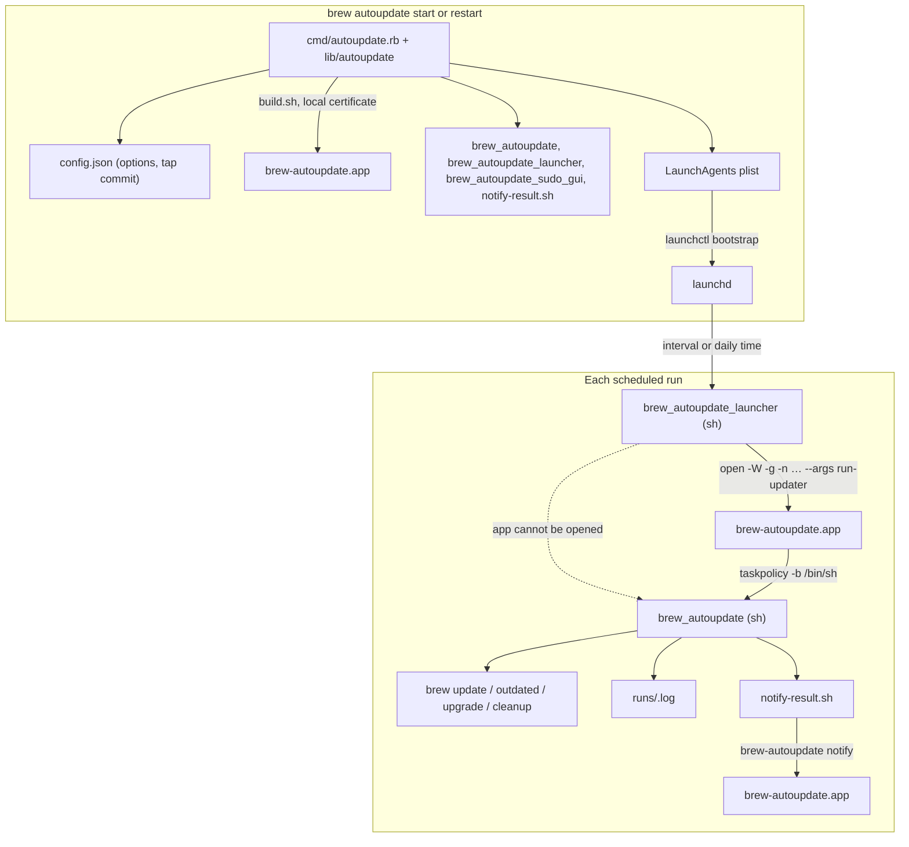

# Architecture

The specification of `brew autoupdate` as this fork implements it: what it
must do, how its parts fit together, the platform behaviour it relies on, and
the alternatives it rules out. Users want the [README](README.md);
contributors want [CONTRIBUTING](CONTRIBUTING.md).

Scope: a personal fork of
[DomT4/homebrew-autoupdate](https://github.com/DomT4/homebrew-autoupdate),
used only by its maintainer and not published for others. It requires
macOS 15 or later and Homebrew 5.1.12 or later.

Platform facts marked **verified** were tested on an Intel Mac and an Apple
silicon Mac, both on macOS 15.8.3 with Swift 6.1.2 (SDK 15.5), unless stated
otherwise.

## Contents

- [Requirements](#requirements)
- [Overview](#overview)
- [Components](#components)
- [Files on disk](#files-on-disk)
- [Interfaces](#interfaces)
- [Commands](#commands)
- [A scheduled run](#a-scheduled-run)
- [The app](#the-app)
- [Signing](#signing)
- [Applying tap changes](#applying-tap-changes)
- [Security model](#security-model)
- [Platform behaviour relied on](#platform-behaviour-relied-on)
- [Known issues](#known-issues)
- [Rejected alternatives](#rejected-alternatives)
- [Conventions](#conventions)
- [Relationship to upstream](#relationship-to-upstream)
- [References](#references)

## Requirements

1. **Self-registering subcommands.** Each subcommand is a
   `Homebrew::AbstractSubcommand` in its own file; `cmd/autoupdate.rb` lists
   no subcommands, options or dispatch.
2. **Small, clean Ruby.** Prefer Homebrew's helpers and remove anything
   unused.
3. **No needless duplication across Ruby, Swift and shell.** Names that must
   be repeated are checked by a test.
4. **No compatibility with upstream.** The fork has its own names, and keeps
   no legacy setups, shims or switches.
5. **Everything that runs is verifiable.** Every script a job runs is
   readable, and the app is built from source on the user's Mac.
6. **Jobs are isolated from tap changes.** A `brew update` that changes this
   tap must not change what a registered job runs, even partway through a run.
7. **Tap changes are applied by a manual restart, with a mandatory
   reminder.**
8. **App Management survives app rebuilds and Ruby upgrades,** through an app
   signed with a certificate made on the user's Mac.
9. **No distributed binaries, and no notarization bypass.** Nothing is
   distributed prebuilt. Any binary ever given to others must be notarized;
   delivering an unnotarized binary through `git` (which escapes quarantine)
   is not acceptable.

## Overview

`brew autoupdate start` builds and signs the app, writes everything a job
needs into the job's own folder and loads a launch agent. Each scheduled run
goes through the app, so macOS checks the app's App Management permission
rather than that of Homebrew's portable Ruby, which changes identity on every
upgrade ([#163](https://github.com/DomT4/homebrew-autoupdate/issues/163)).

## Components

Everything a job runs lives in the support directory, written by `start` or
`restart`; the tap only holds sources (requirement 6).

| Component | Language | Runs | Called by | Lives in |
| --- | --- | --- | --- | --- |
| `cmd/autoupdate.rb` | Ruby, `AbstractCommand` | `brew autoupdate …` | Homebrew | tap |
| `lib/autoupdate/{start,stop,restart,delete,status,logs,version}.rb` | Ruby, `AbstractSubcommand` | management time | `cmd/autoupdate.rb` | tap |
| `lib/autoupdate/{setup,signing,launchd}.rb` | Ruby, needs Homebrew | management time | the subcommands | tap |
| `lib/autoupdate/{config,script,launch_agent,launcher,interval,notify,core}.rb` | Ruby, dependency-free generators | management time; loaded directly by tests | the modules above | tap |
| `app/build.sh` | Bash | when `start` needs a new app; CI | `Autoupdate::Setup` | tap |
| `brew-autoupdate.app` | Swift (`app/BrewAutoupdate.swift`) | each run, and to notify | the launcher, `notify-result.sh` | support directory |
| `brew_autoupdate` (the updater) | generated shell | each run | the app (or the launcher as a fallback) | support directory |
| `brew_autoupdate_launcher` | generated shell | each run | launchd | support directory |
| `brew_autoupdate_sudo_gui` | generated shell | when a cask upgrade needs `sudo` | `sudo -A` | support directory |
| `notify-result.sh` | shell, copied from `app/` | end of each run | the updater | support directory |

## Files on disk

`<label>` is `com.github.hybras.homebrew-autoupdate`; `…` is
`~/Library/Application Support/<label>`.

| Path | Written by | Contents |
| --- | --- | --- |
| `~/Library/LaunchAgents/<label>.plist` | `start` | schedule, log path, runs the launcher |
| `…/config.json` | `start` | saved options, captured environment, the tap's commit |
| `…/brew-autoupdate.app` | `start`, when its source or certificate changed | the app |
| `…/brew_autoupdate`, `…/brew_autoupdate_launcher`, `…/brew_autoupdate_sudo_gui`, `…/notify-result.sh` | `start`, every time | the job's scripts, mode `0555`, written atomically and only when changed |
| `…/brew_autoupdate.status` | the app | exit status of the current or last run |
| `…/app_management` | the updater | whether the last run that upgraded casks had App Management, with the time |
| `~/Library/Logs/<label>/runs/<time>.log`, `<time>.outdated.json` | the updater | each run's output and what it was about to upgrade; the newest 30 runs are kept |
| `~/Library/Logs/<label>/<label>.out` | launchd and the app | one line per run, plus errors outside a run |
| Login keychain: `brew-autoupdate local signing` | `start`, once | the signing certificate and its private key |
| TCC and notification databases | macOS | App Management and notification permission |

## Interfaces

Every contract that crosses a language or process boundary. The launcher,
the app and the scripts are always produced together by one `start`, so these
contracts carry no versioning.

| Interface | Producer → consumer | Contract |
| --- | --- | --- |
| `run-updater` | launcher → app | `brew-autoupdate run-updater <log> <launcher-pid>`. The app runs the fixed path `…/brew_autoupdate` with `BREW_AUTOUPDATE_RUN_BY_APP=1`, appends its output to `<log>`, and stops the updater's process group when `<launcher-pid>` exits or the app receives `SIGTERM` |
| Exit status | app → launcher | the app writes it to `brew_autoupdate.status` (signals as 128 + n), because `open -W` does not return it; the launcher deletes the file before each run and treats a missing file as failure |
| `notify` | `notify-result.sh` → app | `brew-autoupdate notify <title> <subtitle> <message>` |
| Run result | updater → `notify-result.sh` | `notify-result.sh <status> <run-log> <always\|error\|never> <app-path> <reminder>`; the outdated list is `<run-log>` with `.outdated.json` in place of `.log` |
| Saved options | `start` → `start`, `restart`, `status` | `config.json`, `"version": 2` |
| App Management record | updater → `status` | `app_management`: `granted`, `not granted` or `not checked: <reason>`, then the time |
| Source hash | `build.sh` → `Setup.build_app` | Info.plist key `BrewAutoupdateSourcesSHA256`: SHA-256 of `BrewAutoupdate.swift` followed by `build.sh` |
| Shared names | Ruby (`core.rb`), Swift, `build.sh` | support directory, `brew_autoupdate`, `brew_autoupdate.status` and the bundle ID; duplicated, and checked by `test/constants_test.rb` |

## Commands

| Command | Behaviour |
| --- | --- |
| `start [interval] [options]` | Fails if the job is loaded (pointing at `restart`). Validates options, saves `config.json` with the tap's commit, builds and signs the app unless it is current, writes the scripts and the plist, and runs `launchctl bootstrap gui/<uid>`. With no interval or options after `stop`, it reuses the saved options. |
| `restart` | `bootout` if loaded, then `start` with the saved options. Fails if there are none. |
| `stop` | `launchctl bootout`; files are kept. The app sees the launcher exit and stops a running update. |
| `delete` | `bootout`, delete the signing certificate and key from the login keychain, then remove the plist, the support directory and the logs. |
| `status` | Whether the job is loaded (an exact `launchctl print`), the saved options, the run log folder, who signed the app (`codesign -dvv`), the last App Management record, and the restart reminder when the tap's commit differs. |
| `logs [--lines=N] [--follow]` | The newest run's log. |
| `version` | `VERSION` and recent changes from `git log`. |

**Options.** `--upgrade`, `--greedy`, `--cleanup`, `--immediate` (`RunAtLoad`),
`--sudo` (needs `pinentry-mac`), `--leaves-only`, `--only=<names>` (needs
`--upgrade`; names must match `[a-zA-Z0-9\-_.@/]+`, as they are written into
the script), `--ac-only`, `--notify-on-error`, `--no-notify`. The interval is
seconds, a duration (`30m`, `12h`, `1d`, `1w`) or a daily `HH:MM`
(`StartCalendarInterval`).

**Captured environment.** `start` saves `PATH`, `HOMEBREW_CACHE`,
`HOMEBREW_LOGS`, `HOMEBREW_DEVELOPER`, `HOMEBREW_NO_ANALYTICS`,
`HOMEBREW_CASK_OPTS` and, without `--sudo`, the user's `SUDO_ASKPASS`, and
exports them in every run.

**Help.** Subcommands are classes nested in `Homebrew::Cmd::Autoupdate`,
registered through `AbstractSubcommand.define_all`. `lib/` is therefore loaded
before `cmd_args`, which slightly slows `--help`.

## A scheduled run

1. launchd starts `brew_autoupdate_launcher` (`ProcessType` `Background`,
   low-priority I/O).
2. The launcher deletes the status file and runs
   `open -W -g -n <app> --args run-updater <log> $$`. If `open` fails, it
   runs the updater directly.
3. The app checks that the support directory and the updater are owned by
   the user and not writable by others, then runs
   `taskpolicy -b /bin/sh brew_autoupdate`. `taskpolicy` restores the
   background priority that LaunchServices does not pass on.
4. The updater:
   1. with `--ac-only`, exits unless `pmset` reports AC power
   2. exports `HOMEBREW_NO_BOTTLE_SOURCE_FALLBACK=1`, the captured
      environment and, with `--sudo`, `SUDO_ASKPASS`
   3. when upgrading casks, records App Management
      ([below](#app-management-record))
   4. runs, into `runs/<time>.log`, a chain that stops at the first failure:
      `brew update`; with `--upgrade`, `brew outdated --json=v2` with the
      upgrade's scope saved as `<time>.outdated.json` (its exit status
      ignored, since it exits 1 when named packages are outdated), then
      `brew upgrade --no-ask` for formulae (all, leaves or `--only`), then
      casks; with `--cleanup`, `brew cleanup`
   5. compares the tap's `HEAD` with the commit in `config.json`, and sets the
      restart reminder if they differ
   6. calls `notify-result.sh`
   7. deletes all but the newest 30 run logs and their outdated lists
   8. exits with the chain's status
5. The app writes the status file and exits with the same status. The
   launcher exits with it.

### Notifications

`notify-result.sh` posts through the app, according to the `--notify-…` mode:

- **Success:** "Upgraded name old → new, …" built with `/usr/bin/jq` from the
  outdated list, skipping pinned formulae; "Nothing needed upgrading." when it
  is empty; otherwise a line from the log ("already up-to-date" or a generic
  success).
- **Failure:** the exit status and the end of the run's log.
- **Restart reminder:** appended to the message, and shown even in
  `--notify-on-error` mode.
- If the app cannot post, the run's log records "could not display the
  update result"; the run itself still succeeds.

The list is what was outdated before upgrading. It equals what was upgraded
because the chain stops at its first failure.

### App Management record

macOS only lets Homebrew upgrade an app in place (keeping its Dock position
and settings) with App Management permission; without it, Homebrew reinstalls
the app. The System Settings list does not reliably show the permission
([why](#system-settings)), so each run that upgrades casks tests it the way
Homebrew's `Cask::Quarantine.app_management_permissions_granted?` does: it
creates and removes `.homebrew-write-test` in the first app bundle the user
owns in `~/Applications`, then `/Applications`.

- Only a run started by the app records a result
  (`BREW_AUTOUPDATE_RUN_BY_APP`). macOS judges the process responsible for
  the write, so the same test from `status` would test the terminal and
  prompt to grant App Management to it.
- No owned app means `not checked`.

## The app

- **Source:** `app/BrewAutoupdate.swift`, one file, Swift 6 language mode.
  Its two commands are `notify` and `run-updater` ([Interfaces](#interfaces)).
- **Bundle:** ID `com.github.hybras.homebrew-autoupdate.autoupdater`;
  `LSUIElement`; `LSMinimumSystemVersion` 15.0; version from `VERSION`.
  Changing the bundle ID resets App Management and notification permission.
- **Build (`app/build.sh <output.app>`, `CODESIGN_IDENTITY` required):**
  1. compiles `arm64` and `x86_64` for macOS 15 and joins them with `lipo`
  2. writes Info.plist, including the source hash
  3. signs with the Hardened Runtime and verifies with
     `codesign --verify --deep --strict`
  4. moves the result over the output, keeping the previous app until the new
     one verifies in place
- **Rebuild rule:** `start` rebuilds only when the source hash differs or the
  app's designated requirement does not name the current certificate
  (`certificate leaf = H"<sha1>"`). A rebuild takes about a minute and needs
  the Command Line Tools. Replacing the app during a run is safe: the running
  process keeps the old file open.
- **The main executable must be compiled.** With a script as the main
  executable, macOS holds `/bin/sh` responsible, and interpreted Swift cannot
  post notifications ([verified](#app-shape)).
- **Location:** under the home folder. macOS refuses notification permission
  to apps in `/tmp` ([verified](#notification-permission)).
- **Ad-hoc signing (`CODESIGN_IDENTITY=-`)** is for tests and CI only. An
  ad-hoc app's identity is its code hash, so every change would lose the App
  Management grant.

## Signing

`Autoupdate::Signing` manages one self-signed code-signing certificate in the
user's login keychain.

- **Name and lookup:** `brew-autoupdate local signing`, found with
  `security find-identity -p codesigning <login keychain>`; `codesign` is
  given its SHA-1. Only the login keychain is searched.
- **Creation (when missing):**
  1. `/usr/bin/openssl` (LibreSSL) makes an RSA 2048 key and a certificate
     valid for 10 years, with `basicConstraints CA:false`,
     `keyUsage digitalSignature` and `extendedKeyUsage codeSigning`, all
     critical
  2. it exports a `.p12` with the legacy algorithms `security import`
     accepts (`-macalg sha1 -keypbe PBE-SHA1-3DES -certpbe PBE-SHA1-3DES`),
     protected by a random password that exists only in memory and is
     deleted with the temporary directory
  3. `security import … -k <login keychain> -T /usr/bin/codesign`
  4. `start` warns, `mkcert`-style, what it created, that macOS will ask for
     the login password, and how to remove it
- **Password per build (verified):** the key's partition list is not
  changed, so every build's `codesign` asks for the login password in a macOS
  dialog. "Allow" signs that build only; the maintainer does not choose
  "Always Allow", which would let `codesign` use the key without asking.
  Nothing about the keychain is stored on disk. Builds only happen in an
  interactive `start` or `restart`, and only when the app's source or the
  certificate changed, so most restarts ask nothing.
- **No trust setting:** grants follow the certificate without one, and adding
  one would need an administrator prompt.
- **Expiry:** `codesign` refuses an expired identity, so builds stop after 10
  years; existing grants keep working ([verified](#certificate-expiry)).
- **Replacement:** a new certificate (after `delete`, or if it was removed by
  hand) means rebuilding the app and granting App Management again.
- **Removal:** `delete` runs `security delete-identity -c <name>` on the login
  keychain.

## Applying tap changes

A job runs only its snapshot in the support directory. After the tap's
source changes, by `brew update` or local edits, `brew autoupdate restart`
rebuilds the snapshot from the saved options. App Management is kept, because
the certificate is unchanged.

- **Source of truth:** `start` records the tap's git commit in
  `config.json`. A restart is due when the tap's `HEAD` differs. A commit is
  used rather than `VERSION`, since most changes land without a version bump.
- **Reminders (mandatory):**
  - each run checks after `brew update`, in shell, so the check needs no
    Ruby and no tap trust; the reminder goes into the run's log and its
    notification
  - `status` prints the same reminder, so it is seen even without
    notifications
- **Not detected:** uncommitted edits, which leave `HEAD` unchanged.
- Homebrew offers no hook to do this automatically: there is no tap
  post-update hook, and `brew update` disables git hooks
  (`cmd/update.sh:82-85`). The command's Ruby only loads when `brew
  autoupdate` runs or its help is read (`brew.rb:101`, `commands.rb`), so any
  Ruby-side check belongs in `run`.

## Security model

**Safeguards:**

- The app runs only its fixed updater path, and refuses it unless the file
  and its folder are owned by the user and not writable by others.
- `--only` names are validated before being written into a script.
- Generated scripts are read-only (`0555`).

**Accepted risks** (only the maintainer uses this fork):

- Code the user can write (the job's scripts, Homebrew, taps) runs with the
  app's App Management permission. Granting it to Ruby or a terminal would
  expose the same.
- While the user answers the password dialog for a build, the program asking
  is `codesign`, whoever ran it. "Always Allow", if chosen, would let any
  process running as the user sign code with the certificate unprompted.
- Each run that upgrades casks briefly writes a file into an app the user
  owns, as Homebrew does before each cask upgrade.

## Platform behaviour relied on

### App Management

**Verified** with a probe calling Homebrew's
`Cask::Quarantine.app_management_permissions_granted?` against an installed
cask app, launched as a job launches the app (`open -W -g -n <app> --args
run-updater`). The TCC log (`log show --predicate 'process == "tccd"'`) named
the responsible identity each time, and a never-granted control app was always
denied. Results were the same on Intel and Apple silicon.

- An app opened through LaunchServices is the responsible process; the
  updater and `brew` it starts are judged as the app.
- A grant for the app survives portable Ruby upgrades (tested 4.0.10 to
  4.0.9_1).

How a grant reacts when the app changes:

| Change | Ad-hoc | Self-signed | Developer ID |
| --- | --- | --- | --- |
| Identical bytes | kept | kept | kept |
| Different source or toolchain | lost (new code hash) | kept with the same certificate | kept with the same team and bundle ID (from the requirement; untested) |
| Moved to another folder | kept | kept | kept |
| New bundle ID | lost | lost | lost |
| New certificate | n/a | lost | n/a |

A self-signed designated requirement is
`identifier "<bundle-id>" and certificate leaf = H"<sha1>"`, independent of
the binary.

### Certificate expiry

**Verified:** `codesign` refuses an expired identity
(`CSSMERR_TP_CERT_EXPIRED`), but grants for apps signed before the expiry are
still honoured afterwards, even with the certificate deleted.

### Notification permission

**Verified**, with fresh bundle IDs and ad-hoc signatures:

| App location | First request |
| --- | --- |
| `/tmp` (with or without `lsregister`) | refused with no prompt |
| `~/Applications` | prompt, then allowed |
| `~/Library/Application Support` | prompt, then allowed |

- Permission belongs to the bundle ID
  (`~/Library/Preferences/com.apple.ncprefs.plist`); each new signature is
  added under it, so rebuilds and re-signing never ask again.
- A rebuilt or moved app keeps the permission once LaunchServices has
  registered it. The launcher's `open` registers it on every run.

### System Settings

**Verified:** the App Management list is not a reliable view of the
permission. Apps blocked by it did not always appear; apps added with "+"
did not appear either, yet were then allowed. Allowing the "prevented from
modifying apps" notification alone does not grant it.

### App shape

**Verified:** an app whose main executable is a shell script has a stable
ad-hoc signature, but macOS holds `/bin/sh` responsible (`responsible=com.apple.sh`),
its children are denied, and Swift scripts it runs cannot use
`UNUserNotificationCenter` (they run inside `swift-frontend`, outside any
bundle). A symlink as the main executable is no better: macOS judges the
target, whose identity changes with every upgrade of the target (the same
mechanism as #163).

### Reproducible builds

**Verified:** builds of one commit are bit-for-bit identical (executable,
Mach-O UUIDs, code hash) across source paths and across Intel and Apple
silicon hosts with the same Swift and SDK, and embed no paths. With a
different SDK (CI's 26.5) about 65% of bytes differ. The toolchain comes from
the user's Command Line Tools and cannot be pinned. See Homebrew's
[Reproducible Builds](https://docs.brew.sh/Reproducible-Builds).

### Gatekeeper and quarantine

- Apple requires software distributed with a Developer ID to be notarized
  ([Apple](https://developer.apple.com/documentation/security/notarizing-macos-software-before-distribution)).
- **Verified:** upstream's Developer ID app is assessed as "rejected,
  source=Unnotarized Developer ID" (`spctl -a -vv -t exec`) and still runs,
  because Gatekeeper only enforces its verdict on quarantined files, and git
  does not quarantine. Apps built locally are never quarantined.
- Casks are quarantined at extraction (`cask/download.rb:128`), and
  `cask/audit.rb` fails artifacts that do not pass Gatekeeper.

### Homebrew's cask sandbox

Cask `preflight` steps run sandboxed with a temporary `HOME`
(`cask/artifact/abstract_artifact.rb:216,239-258`), and reading
`~/Library/Keychains` is denied (`sandbox.rb:527`), so a cask cannot sign with
a keychain identity.

## Known issues

### macOS 27 may refuse notifications

Not handled; unverified, as no macOS 27 machine has been tested.
[#255](https://github.com/DomT4/homebrew-autoupdate/issues/255) (macOS 27.2,
Apple silicon) reports that macOS refuses notification permission, without a
prompt, to apps that are not notarized, including ad-hoc and self-signed
ones. This app cannot be notarized (requirement 9).

- **Would stop:** run notifications, including failures and the restart
  reminder.
- **Would keep working:** scheduled updates; each run's log in
  `brew autoupdate logs`, which records "could not display the update
  result"; the restart reminder in `status`.
- **Untested there:** App Management through the self-signed app.
- **If confirmed:** make notifications optional and have `status` show the
  last run's result.

### Other limitations

- Tested on macOS 15 only.
- After a failed formula upgrade, casks are not upgraded in that run.
- No network or Low Power Mode checks.

## Rejected alternatives

| Alternative | Why not |
| --- | --- |
| `brew services` via a formula | options would be fixed in the formula |
| Homebrew's `HOMEBREW_AUTO_UPDATE_SECS` | only runs when the user runs `brew` |
| A binary committed to git, signed by a developer | distributes an unnotarized binary through git (requirement 9) |
| A notarized release installed by a cask or downloaded by `start` | distributes a binary (requirement 9); needs a paid Developer ID |
| A cask that builds the app | the cask sandbox cannot reach the keychain; `brew upgrade` would replace the app mid-run (requirement 6) |
| Detached signatures applied to local builds (Bitcoin Core's model) | needs byte-identical builds, so a pinned toolchain |
| Ad-hoc signing for real jobs | every app change loses the App Management grant |
| A dedicated keychain with its password stored on disk | a password on disk; the login keychain needs none |
| A script or symlink as the app's main executable | macOS judges the shell or the symlink's target ([App shape](#app-shape)) |
| `SMAppService` background job registered by the app, with or without a long-lived scheduler and IPC | more Swift and untested platform behaviour for no gain over launchd plus the launcher |
| A hidden `brew autoupdate run` each run | would run whatever the tap holds (requirement 6) and need tap trust |
| The job refreshing itself after `brew update` | unattended builds and signing with no one to answer prompts or failures |
| Versioned snapshots with an atomic `current` symlink | not needed with one snapshot rewritten atomically |
| Generating shared constants from one source | a test that compares them costs less |
| Text parsing of `brew upgrade` output for summaries | `brew outdated --json=v2` is structured |
| One shared log file | grew without bound; per-run logs are easier to read and prune |
| Sorbet signatures in `lib/` | plain `ruby` loads those files for tests and cannot load `sig` |

## Conventions

- **Ruby:** `brew style` (taps use `tap_rubocop_style.yml`); Homebrew helpers
  (`SystemCommand`, `odie`, `opoo`) in modules that need Homebrew;
  dependency-free generators stay loadable by plain `ruby`; `cmd/` is
  `typed: strict`, `lib/` has no Sorbet.
- **Swift:** `swift format`.
- **Shell:** ShellCheck with every check, and shfmt, through `brew style`. A
  tap inside the Homebrew checkout inherits Homebrew's `.shellcheckrc`, which
  disables SC2310–SC2312; CI does not.
- **Markdown:** markdownlint in the editor.
- **Tests:** minitest per area. `AbstractSubcommand` classes need Homebrew
  loaded, so they are tested through `brew` (`test/command_test.rb`).
- **Releases:** a `version: bump` commit updating `VERSION`; no automation.
  Dependabot updates pinned actions; CI regenerates the README help on
  `main`.
- **Commits:** `area: summary` subjects.

## Relationship to upstream

Differences from upstream:

- Runs go through the app, so App Management survives portable Ruby upgrades
  ([#163](https://github.com/DomT4/homebrew-autoupdate/issues/163),
  [#253](https://github.com/DomT4/homebrew-autoupdate/issues/253)), and
  `status` reports it.
- The app is built and signed locally; upstream commits a Developer ID app
  that is not notarized.
- Jobs are isolated from tap changes, with restart reminders.
- Saved options, `restart`, self-registering subcommands, per-run logs, and
  notifications that list upgraded versions.
- Fixed bugs: a `launchctl list` substring match that made a stopped setup
  look running; `--leaves-only` reporting failures as success; the password
  prompt's missing icon; notifications breaking for forks tapped under another
  name.
- Costs: `start` needs the Command Line Tools and about a minute to build; a
  signing key any process running as the user can use; possible notification
  loss on macOS 27.

Neither merging upstream nor replacing it is planned. A merge would need
reviewable pull requests by area, and upstream would have to build locally or
notarize. A replacement has no command migration in Homebrew
(`tap_migrations.json` covers only formulae and casks), the two taps cannot
both provide `brew autoupdate`, and users would grant App Management and
notifications again under the new names.

## References

- Homebrew: [External Commands](https://docs.brew.sh/External-Commands),
  [Reproducible Builds](https://docs.brew.sh/Reproducible-Builds),
  [Tap Trust](https://docs.brew.sh/Tap-Trust)
- Apple: [Notarizing macOS software before distribution](https://developer.apple.com/documentation/security/notarizing-macos-software-before-distribution)
- Issues: [#163](https://github.com/DomT4/homebrew-autoupdate/issues/163),
  [#253](https://github.com/DomT4/homebrew-autoupdate/issues/253),
  [#255](https://github.com/DomT4/homebrew-autoupdate/issues/255)
